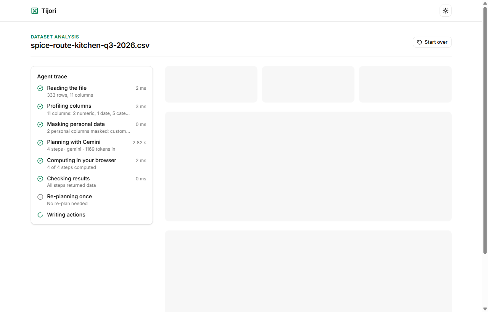
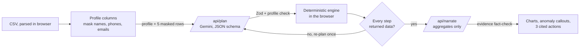

<div align="center">

# Tijori

**Your sales ledger, read by an AI analyst that never sees your customers.**

*Tijori* (तिजोरी) is Hindi for "vault": the data stays locked in your browser, only the insight comes out.

[**Live demo**](https://hackathon-new-sooty.vercel.app) · one click on *Try sample data*, no sign-up

[](https://github.com/webtools-dotcom/hackathon-new/actions/workflows/ci.yml)


Built for **Prompt War 2026** (NMIET x Google for Developers) · Vertical: **Data and business intelligence for small businesses**

</div>

![Tijori home screen: headline on the left, and on the right a live panel showing three raw sample rows with customer names and phone numbers above the same rows as sent to Gemini, with those columns replaced by [name] and [phone]](docs/screenshots/hero.png)

## The problem

India has over six crore small businesses. A restaurant owner in Pune can export three months of orders from a billing app in one click. What they can't do is answer the questions that matter: *which outlet is slipping, which delivery channel actually pays, why did one week go quiet?*

The obvious shortcut, pasting the file into a chatbot, has two real costs:

1. **Privacy.** Every customer's name and phone number is handed to a third party.
2. **Trust.** Language models are bad at arithmetic over hundreds of rows, and a wrong number that *looks* right is worse than no number.

## The idea: the model decides, the code computes

Tijori splits the work so that each side does only what it is good at.

| | Gemini does | Your browser does |
|---|---|---|
| **Sees** | Column names, types, ranges, 5 masked sample rows, final aggregates | Every raw row |
| **Decides** | *Which* analyses answer the question (a typed plan) | Nothing: it executes the plan exactly |
| **Computes** | No numbers at all | Every number on the screen |
| **Writes** | Three actions, each citing its evidence | A fact-check of every cited number |

The result: **0 raw rows** and **12.5% of the file's bytes** reach the model, and a hallucinated number cannot reach the screen, because the server rejects any action whose evidence doesn't match the computed results.



## How it works



| Step | Where | What happens |
|---|---|---|
| 1. Profile and mask | Browser · [`profile.ts`](src/lib/engine/profile.ts), [`mask.ts`](src/lib/engine/mask.ts) | Each column is typed (number, date, category, text, personal). Names, Indian phone numbers and emails are detected by column name and value pattern, then masked. |
| 2. Plan | Server · [`api/plan`](src/app/api/plan/route.ts), [`gemini.ts`](src/lib/server/gemini.ts) | Gemini returns JSON constrained by a schema generated from the Zod types. The plan is validated again and checked against the real profile: unknown columns, personal columns and wrong types are rejected, with one automatic repair call. |
| 3. Execute | Browser · [`execute.ts`](src/lib/engine/execute.ts) | Only allow-listed operations: total, group-by with top-N, and day/week/month trend, with sum/avg/count and simple filters. No `eval`, no generated code. |
| 4. Verify and re-plan | Browser · [`run-agent.ts`](src/lib/agent/run-agent.ts) | If any step fails or comes back empty, the agent sends Gemini the failure reasons and re-plans once. |
| 5. Detect anomalies | Browser · [`anomaly.ts`](src/lib/engine/anomaly.ts) | A robust z-score (median and MAD) flags unusual periods, ignoring partial edge periods. On the sample data it finds the week one outlet was shut, without being told. |
| 6. Narrate and fact-check | Server · [`api/narrate`](src/app/api/narrate/route.ts), [`verify.ts`](src/lib/engine/verify.ts) | Gemini writes three actions, each with `{stepId, label, value}` evidence. Any action whose numbers don't match the computed results within 0.5% is dropped and replaced by a rules-based one. |
| 7. Degrade gracefully | [`fallback.ts`](src/lib/engine/fallback.ts) | No key, a 429 or no network: a deterministic plan and rules-based actions take over, clearly labelled as offline. The demo never breaks on stage. |

Everything the model saw is one click away: the **"What the model saw"** drawer shows the exact JSON payloads next to the size of your file.

## Measured results

Measured on the live deployment with the built-in sample dataset (333 orders, 11 columns, 3 Pune outlets), model `gemini-3.5-flash-lite`:

| Metric | Result | Source |
|---|---|---|
| Raw rows sent to the model | **0** (plus 5 masked sample rows) | By construction, tested in [`run-agent.test.ts`](src/lib/agent/run-agent.test.ts) |
| Bytes sent vs. file size | **4.4 KB of 33.3 KB (13.3%)** | [`bench/results.json`](bench/results.json), generated by [`measure.test.ts`](src/lib/engine/measure.test.ts) |
| End-to-end time | **5.0 s** (planning 2.8 s, actions 2.2 s; all in-browser steps together under 10 ms) | In-app metrics panel, live run |
| Tokens per analysis | 1,897 in / 860 out | Gemini `usageMetadata`, live run |
| Repeat analysis of the same schema | Served from cache, no model call | [`cache.ts`](src/lib/server/cache.ts) |
| Tests | **76 passing** across 19 files | `npm test` |

## How this maps to the evaluation criteria

| Criterion | What we did | Verify |
|---|---|---|
| **Problem alignment** | A real owner's question ("why did August dip?") answered with charts, an anomaly callout and three actions in about 5 seconds | Live demo, *Try sample data* |
| **Security** | Server-only API key; strict Zod on every request and every model output; allow-listed operations only; PII masked before any network call; 32 KB body cap; 20 req/min per IP; CSP and security headers; generic error codes | [`SECURITY.md`](SECURITY.md), `npm test` |
| **Efficiency** | Profiles and aggregates instead of rows (13% of bytes); response cache keyed by schema and question; one re-plan maximum; Flash-Lite model | [`bench/results.json`](bench/results.json) |
| **Testing** | 76 Vitest tests: profiler, masking, engine, anomaly detector, evidence check, rate limit, cache, routes with Gemini mocked, the full agent loop, headline selection, security headers; plus an opt-in live Gemini test and a benchmark | `npm test`, `npm run test:live`, `npm run bench` |
| **Accessibility** | Skip link and landmarks; labelled inputs; keyboard-operable upload, drawer and tabs; focus returns after the dialog closes; visible focus rings; status shown by icon and text, never colour alone; every chart backed by a screen-reader data table (the SVG itself is hidden from assistive tech); `aria-live` progress; reduced-motion support; light and dark themes; works at 375 px | [`src/components/analyst/`](src/components/analyst) |
| **Code quality** | TypeScript strict with no `any`; pure, unit-tested engine separated from UI and server; typed contracts shared end to end; CI runs lint, types, tests, build and audit on every push | [`.github/workflows/ci.yml`](.github/workflows/ci.yml) |
| **Google technology** | Gemini API through the official `@google/genai` SDK, used twice per analysis with schema-constrained JSON output | [`gemini.ts`](src/lib/server/gemini.ts) |

## Security model

Full threat model in [`SECURITY.md`](SECURITY.md). The short version:

- **The key never leaves the server.** `GEMINI_API_KEY` is read inside the request handler ([`gemini.ts`](src/lib/server/gemini.ts)), never prefixed `NEXT_PUBLIC_`, never committed. The build passes with no secrets.
- **Uploaded data is data, not instructions.** Both system prompts tell the model to ignore instructions inside column names or values ([`prompts.ts`](src/lib/server/prompts.ts)). Even if an injection succeeded, the model can only choose from allow-listed operations on columns that exist, and the plan is re-validated against the profile.
- **Model output is untrusted input.** It is parsed with Zod on the server, and API responses are validated again in the browser; nothing the model returns is executed or rendered as HTML.
- **Abuse limits.** 32 KB request cap and strict schemas that reject unknown keys ([`contracts.ts`](src/lib/server/contracts.ts)); 20 requests per minute per IP ([`rate-limit.ts`](src/lib/server/rate-limit.ts)); 15 s timeout and bounded retries with backoff.
- **Browser hardening.** CSP with `frame-ancestors 'none'`, HSTS, `X-Frame-Options: DENY`, `nosniff`, a strict Referrer-Policy and Permissions-Policy on every route ([`security-headers.ts`](src/lib/security-headers.ts)).
- **Dependencies.** `npm audit --omit=dev` reports 0 vulnerabilities; CI checks it on every push.

## Google technology used

- **Gemini API** via the official [`@google/genai`](https://www.npmjs.com/package/@google/genai) SDK:
  - **Planning:** `responseMimeType: "application/json"` with `responseJsonSchema` derived from the Zod `PlanSchema`, so the model can only answer in the allow-listed shape.
  - **Narration:** structured actions with machine-checkable evidence.
  - Token usage from `usageMetadata` is shown in the app; 429 and 5xx responses are retried with exponential backoff.
- **Google AI Studio** for the API key. The model is set by `GEMINI_MODEL` (default `gemini-3.5-flash-lite`).

## Assumptions

- Input is a CSV with a header row, up to 5 MB and 40 columns, such as a POS or billing-app export.
- Dates are `YYYY-MM-DD`, `DD-MM-YYYY` or `DD/MM/YYYY`; money may include `₹`, `Rs` and Indian digit grouping.
- Personal data is detected by column name and value patterns (names, Indian mobile numbers, emails). An unusually named personal column may need renaming before upload.
- The sample dataset is synthetic and generated with a fixed seed ([`sample-data.ts`](src/lib/sample-data.ts)), including one planted anomaly (an outlet closed for a week in August) so the detector can be checked.
- Rate limiting and caching are in memory, so they apply per server instance; production would use a shared store such as Redis.
- There are no accounts and nothing is stored on the server.

## Run it locally

```bash
npm install
cp .env.example .env.local   # add GEMINI_API_KEY; the app also runs offline without it
npm run dev
```

| Command | What it checks |
|---|---|
| `npm test` | 76 unit and integration tests, Gemini mocked |
| `npm run test:live` | One real Gemini call with your key |
| `npm run bench` | Engine speed on 333 and 20,000 rows |
| `npm run lint` · `npx tsc --noEmit` · `npm run build` | Lint, types, production build |

## Project structure

```
src/
  app/api/plan, app/api/narrate   the only code that talks to Gemini
  lib/engine/                     pure, browser-side: profile, mask, validate, execute, anomaly, verify, fallback
  lib/server/                     gemini client, prompts, contracts, rate limit, cache, http helpers
  lib/agent/run-agent.ts          the plan, execute, verify, re-plan, narrate loop
  components/analyst/             UI: privacy preview, agent trace, charts, actions, payload drawer, metrics
bench/results.json                measured payload sizes, regenerated by the test suite
```

## Built with, and disclosure

Next.js 16 (App Router, TypeScript), Tailwind CSS v4, shadcn/ui, recharts, Zod, Papa Parse, `@google/genai`, Vitest; deployed on Vercel. The project began from a generic Next.js and shadcn/ui starter with no business logic. Development was AI-assisted (Claude Code for planning and review, Gemini-based tools for implementation); every change was reviewed, tested and committed by the author.

## License

[MIT](LICENSE) © 2026 Nishant
