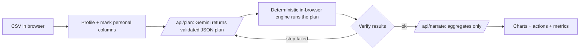

# Tijori

> A secure AI sales analyst for small Indian businesses. Upload a sales CSV, and Gemini plans the analysis, your browser does the maths, and you get three actions backed by real numbers. Customer names and phone numbers never leave the page.

**Live demo:** [https://hackathon-new-sooty.vercel.app](https://hackathon-new-sooty.vercel.app) (one-click sample data, no sign-up)
**Built for:** Prompt War 2026, "Build Beyond AI" (NMIET x Google for Developers)
**Vertical:** Data and business intelligence, for small businesses (restaurants, kirana stores, clinics)

*Tijori* is Hindi for "vault": your data stays locked in the browser and only the insights come out.

## The problem

A restaurant owner in Pune can export three months of orders from a billing app, but has no analyst and no time to work out which outlet is slipping, which channel pays, or why one week went quiet. Pasting the file into a chatbot is risky: it ships every customer's name and phone number to a third party, and the model can invent numbers that look right.

## What it does

- **Plans like an analyst:** Gemini reads only a column profile and 5 masked sample rows, then returns a typed analysis plan (totals, groupings, trends).
- **Computes without hallucinating:** a deterministic engine in the browser runs the plan. Every number on screen comes from code, not from the model.
- **Explains what to do:** Gemini writes three actions, and the server rejects any action whose cited numbers don't match the computed results.
- **Spots problems:** anomalies in trends (for example, a week with an unusual drop) are flagged on the chart with a plain-language callout.
- **Transparent by design:** a live agent trace shows every step with timings, and a "What the model saw" drawer shows the exact payload sent to Gemini next to the raw file size.

Main screen: a sidebar shows the agent trace and a metrics panel; the main column shows the total revenue, bar and area charts (with the anomaly week marked in red), and three numbered action cards with evidence chips.

## How it works



1. **Profile and mask (browser).** Each column is typed (number, date, category, text, personal), and names, phones and emails are detected and masked. See [`profile.ts`](src/lib/engine/profile.ts) and [`mask.ts`](src/lib/engine/mask.ts).
2. **Plan (server, Gemini).** [`/api/plan`](src/app/api/plan/route.ts) sends the profile and masked samples to Gemini with a JSON schema. The output is validated with Zod and checked against the profile (no unknown or personal columns, correct column types). One repair call is made if the plan is invalid. See [`validate.ts`](src/lib/engine/validate.ts).
3. **Execute (browser, deterministic).** [`execute.ts`](src/lib/engine/execute.ts) runs only allow-listed operations: total, group-by with top-N, and time trend, with sum, average or count and simple filters. There is no `eval` and no generated code.
4. **Verify and re-plan.** If a step fails or returns nothing, the agent asks Gemini to re-plan once with the failure reasons. See [`run-agent.ts`](src/lib/agent/run-agent.ts).
5. **Narrate (server, Gemini).** [`/api/narrate`](src/app/api/narrate/route.ts) sends only the computed aggregates. Each action must cite evidence (step, label, value), and [`verify.ts`](src/lib/engine/verify.ts) drops any action with numbers that don't match.
6. **Offline fallback.** With no API key, a rate limit or no network, the app uses a rules-based plan and rules-based actions ([`fallback.ts`](src/lib/engine/fallback.ts)) and labels them as such.

## How this maps to the evaluation criteria

| Criterion | What we did | Where in the code | How to verify |
|---|---|---|---|
| Security | Server-only API key; Zod on every request and model output; allow-listed operations; PII masking in the browser; size caps; per-IP rate limit; security headers | [`src/app/api/`](src/app/api), [`src/lib/server/`](src/lib/server), [`src/lib/security-headers.ts`](src/lib/security-headers.ts) | `npm test`, [`SECURITY.md`](SECURITY.md) |
| Efficiency | Only a profile, 5 masked rows and aggregates are sent; responses are cached by schema and question | [`run-agent.ts`](src/lib/agent/run-agent.ts), [`cache.ts`](src/lib/server/cache.ts) | Metrics panel, "What the model saw" drawer |
| Testing | 65 Vitest tests: engine, masking, validation, routes with Gemini mocked, agent loop | `src/**/*.test.ts` | `npm test` |
| Accessibility | Labelled inputs, keyboard-usable upload and drawer, visible focus, icons plus text for status, hidden data tables behind charts, reduced-motion support, light and dark themes | [`src/components/analyst/`](src/components/analyst) | Keyboard and screen-reader walk-through |
| Google technology | Gemini API through `@google/genai` with schema-constrained JSON output | [`gemini.ts`](src/lib/server/gemini.ts) | `npm run test:live` with a key |

## Measured results

Measured on the built-in sample dataset (333 orders, 11 columns), one run on a local production build with `gemini-3.5-flash-lite`, read from the in-app metrics panel:

| Metric | Result |
|---|---|
| Raw file size vs. data sent to Gemini | 32.5 KB vs. 4.1 KB (12.6%) |
| Raw rows sent to the model | 0 (5 masked sample rows) |
| Tokens (plan + narrate) | 1,909 in / 727 out |
| End-to-end time | 4.27 s (planning 2.52 s, writing actions 1.74 s, all in-browser steps under 10 ms) |
| Tests | 65 passing (`npm test`) |

## Security model

See [`SECURITY.md`](SECURITY.md) for the threat model. In short:

- `GEMINI_API_KEY` is read only on the server at request time ([`gemini.ts`](src/lib/server/gemini.ts)) and never committed.
- Raw rows never leave the browser; personal columns are masked before anything is sent ([`mask.ts`](src/lib/engine/mask.ts)).
- Uploaded content is treated as data: the system prompts tell the model to ignore instructions inside it ([`prompts.ts`](src/lib/server/prompts.ts)), and model output can only select allow-listed operations on existing columns.
- Request bodies are capped at 32 KB and validated with strict Zod schemas; each IP gets 20 requests per minute ([`http.ts`](src/lib/server/http.ts), [`rate-limit.ts`](src/lib/server/rate-limit.ts)).
- CSP, `X-Frame-Options: DENY`, `nosniff`, Referrer-Policy and Permissions-Policy are set for every page ([`security-headers.ts`](src/lib/security-headers.ts)). Clients only ever see generic error codes.

## Google technology used

- **Gemini API** through the official `@google/genai` SDK, used twice per analysis: planning (structured JSON output against a Zod-derived schema) and narration (structured actions with cited evidence). Retries with backoff on 429/5xx, 15 s timeout per attempt.
- **Google AI Studio** for the API key. The model id is configurable through `GEMINI_MODEL`.

## Assumptions

- Input is a CSV with a header row, up to 5 MB and 40 columns.
- Dates are `YYYY-MM-DD`, `DD-MM-YYYY` or `DD/MM/YYYY`; money columns may include `₹`, `Rs` and commas.
- Personal columns are detected by column name and value patterns (names, Indian phone numbers, emails). Unusual naming may need a rename before upload.
- Rate limiting and caching are in memory, so they apply per server instance. A production deployment would use a shared store.
- There are no accounts and nothing is stored on the server.

## Run locally

```bash
npm install
cp .env.example .env.local   # add your GEMINI_API_KEY (optional: the app works offline without it)
npm run dev
```

Checks: `npm run lint`, `npx tsc --noEmit`, `npm test`, `npm run build`. Live Gemini check: `npm run test:live`.

## Tech stack and disclosure

Next.js 16 (App Router, TypeScript), Tailwind CSS v4, shadcn/ui, recharts, zod, papaparse, `@google/genai`, Vitest. The project started from a generic Next.js + shadcn/ui starter with no business logic. Development was AI-assisted with Claude Code and Gemini-based tools; all code was reviewed, tested and committed by the author.

## License

[MIT](LICENSE)
