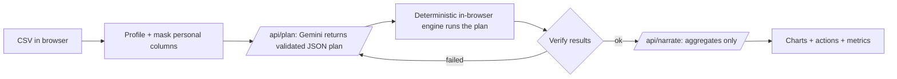

<!--
HOW TO USE: copy this file over README.md. Replace EVERY [BRACKET].
Delete any section or sentence that is not 100% true of the code in this repo.
Fill the numbers only after you have measured them. Never invent a number.
Delete this comment block before committing.
-->

# [PROJECT NAME]

> [One sentence: who it helps, what it does, and the measurable result.]

**Live demo:** [https://YOUR-PROJECT.vercel.app](https://YOUR-PROJECT.vercel.app) (one-click sample data, no sign-up)
**Built for:** Prompt War 2026, "Build Beyond AI" (NMIET x Google for Developers)

[](https://github.com/[USER]/[REPO]/actions/workflows/ci.yml)

## The problem

[2-4 sentences. A specific person, a specific situation, a specific cost. Example: "A restaurant owner exports 3 months of sales from a billing app but has no time or tools to find out which dishes lose money."]

## What it does

- **[Capability 1]:** [what the user gets]
- **[Capability 2]:** [what the user gets]
- **[Capability 3]:** [what the user gets]
- **Transparent by design:** a panel shows exactly what was sent to the model, and per-step timings.

Screenshot description (for readers who cannot see images): [describe the main screen in one or two sentences].


## How it works



1. **Profile and mask (browser).** [one sentence + file link]
2. **Plan (server, Gemini).** [one sentence + file link]
3. **Execute (browser, deterministic).** [one sentence + file link]
4. **Verify and re-plan.** [one sentence + file link]
5. **Narrate (server, Gemini).** [one sentence + file link]

## How this maps to the evaluation criteria

| Criterion | What we did | Where in the code | How to verify |
|---|---|---|---|
| Security | [e.g. key server-side only; Zod validation; allow-listed operations; PII masking] | [`src/app/api/plan/route.ts`](src/app/api/plan/route.ts) | [`npm test`, see `SECURITY.md`] |
| Efficiency | [e.g. only a column profile is sent; response caching] | [file link] | [metrics panel / `npm run bench`] |
| Technology implemented | [e.g. plan-execute-verify agent loop; structured output; typed pipeline] | [file link] | [tests] |
| Performance | [e.g. measured p50 latency; timeouts + retry; demo-mode fallback] | [file link] | [metrics panel] |
| Google technology | [e.g. Gemini API via `@google/genai`, schema-constrained JSON output] | [file link] | [code] |

## Measured results

| Metric | Result | How measured |
|---|---|---|
| Tokens sent vs. raw data size | [X] vs [Y] ([Z]% reduction) | [method] |
| End-to-end latency (sample dataset) | [X] s median over [N] runs | [method] |
| Tests | [N] passing | `npm test` |

## Security model

See [`SECURITY.md`](SECURITY.md) for the full threat model. In short:

- [Control 1 and where it lives]
- [Control 2 and where it lives]
- [Control 3 and where it lives]

## Google technology used

- **Gemini API** through the official `@google/genai` SDK: [how it is used: structured output, etc.]
- [Anything else you really use. Do not list services you do not use.]

## Tech stack and disclosure

- Framework and UI: Next.js, React, TypeScript (strict), Tailwind CSS, shadcn/ui, recharts
- Libraries: `zod`, `papaparse`, [others]
- Model/API: Google Gemini API
- Started from a generic UI starter (Next.js + Tailwind + shadcn/ui, no business logic). All application logic in this repository was written during the event.
- AI-assisted development: Claude Code and Gemini-based coding tools were used to plan and write code; all code was reviewed and tested by the author.

## Getting started

```bash
git clone https://github.com/[USER]/[REPO].git
cd [REPO]
npm ci
cp .env.example .env.local   # add your GEMINI_API_KEY (free from Google AI Studio)
npm run dev
```

Open http://localhost:3000 and click **Try sample data**. Without an API key the app runs in demo mode with cached results.

## Testing and CI

```bash
npm run lint && npx tsc --noEmit && npm test && npm run build
```

GitHub Actions runs the same checks on every push (`.github/workflows/ci.yml`).

## Limitations and next steps

- [Honest limitation 1]
- [Honest limitation 2]
- [What you would build next]

## Project structure

```text
[paste the real tree: `tree -L 3 src` or equivalent]
```

## License

MIT, see [LICENSE](LICENSE).
